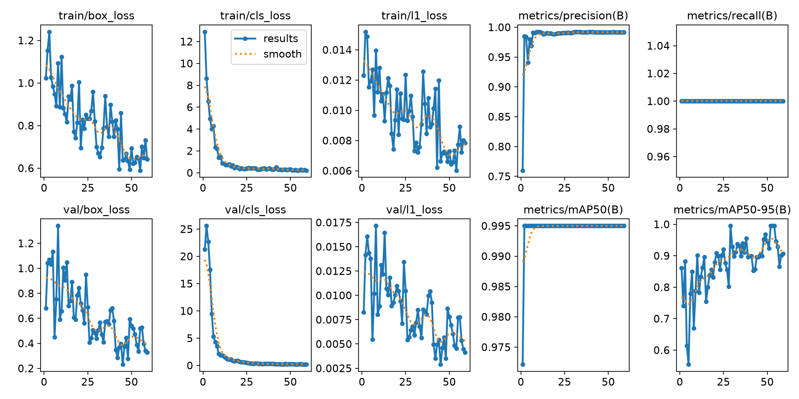
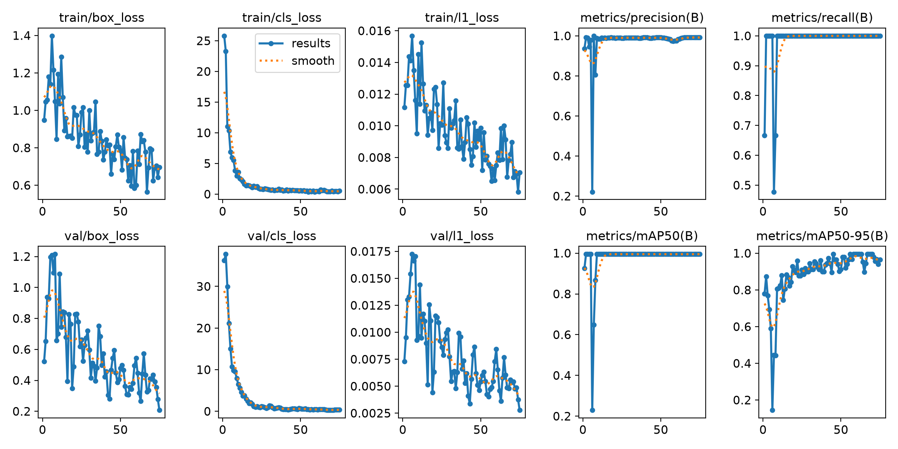

# Project Computer Vision: Deteksi Path Landing (RET503)

**Nama:** Zahkiatul Yasmi
**NIM:** 4222401040
**Mata Kuliah:** Computer Vision and Deep Learning (RET503)

## 1. Deskripsi Proyek
Proyek ini bertujuan untuk mendeteksi objek "path landing" (landasan pendaratan) menggunakan algoritma YOLO. Dataset terdiri dari foto lapangan yang memiliki path landing dan tanpa path landing (background). Dataset telah dianotasi menggunakan Roboflow dan diekspor dalam format YOLO.

*   **Jumlah Kelas:** 1 (`landing_path`)
*   **Link Dataset:** [Google Drive Dataset](https://drive.google.com/drive/folders/1Yt304TzYQOO1anPIL8j070CVePjdHtKd?usp=sharing)

## 2. Metodologi Eksperimen
Eksperimen dilakukan menggunakan model `yolo26n` dengan dua skenario:
*   **E1 (Pretrained):** Baseline menggunakan bobot awal (Transfer Learning) dengan resolusi `imgsz=416`.
*   **E3 (Tuning):** Eksperimen tuning dengan mengubah resolusi gambar menjadi `imgsz=640`.

## 3. Hasil Eksperimen
Berikut adalah tabel perbandingan hasil evaluasi pada data validasi:

*(Di sini kamu bisa menaruh tabel dari file hasil_praktik_4222401040.txt)*

**Grafik E1:**

**Grafik E3:**

## 4. Analisis dan Hasil Test

**A. Pemilihan Model Terbaik**
Meskipun eksperimen E1 dan E3 sama-sama mencapai performa luar biasa pada data validasi dengan `mAP50-95` sebesar 0.995 dan `Recall` 100%, **E1 terpilih sebagai model terbaik**. Hal ini karena E1 jauh lebih efisien dari segi waktu pelatihan (15.4 menit vs 103.9 menit pada E3) dan kecepatan inferensi (42.3 ms vs 78.8 ms).

**B. Evaluasi Model pada Data Test**
Pada pengujian akhir menggunakan data test (data yang belum pernah dilihat model), model E1 berhasil mempertahankan performa tinggi dengan perolehan:
*   **mAP50:** 0.995
*   **mAP50-95:** 0.948
Hal ini membuktikan model tidak mengalami *overfitting* dan sangat reliabel untuk mendeteksi objek *path landing* pada gambar baru.

**C. Analisis Fluktuasi Grafik dan Isu Overfitting (Studi Kasus E3)**
Pada grafik hasil eksperimen, terlihat bahwa metrik `mAP50` dan `Recall` sangat stabil dan langsung mencapai nilai maksimal (0.995 dan 1.0). Namun, metrik `mAP50-95` terlihat fluktuatif (naik-turun) dan pada E3 sempat mengalami penurunan (drop) di awal epoch. Berikut adalah analisis mendalam mengenai fenomena tersebut:

1.  **Pengaruh Ambang Batas Ketat (mAP50-95):** Berbeda dengan `mAP50` yang memiliki toleransi longgar (IoU 0.5), `mAP50-95` mengecek presisi kotak pembatas (*bounding box*) dari toleransi longgar hingga sangat sempit (IoU 0.5 hingga 0.95). Pergeseran kotak hanya sebesar 1-2 piksel dapat menyebabkan nilai `mAP50-95` turun drastis. Karena ukuran dataset validasi relatif kecil, perubahan pada satu-dua gambar sangat mempengaruhi rata-rata nilai secara keseluruhan.
2.  **Instabilitas Gradien di Awal Tuning (E3):** Penurunan performa sementara pada E3 (sekitar epoch ke-6) bukanlah sebuah kegagalan, melainkan efek dari penyesuaian bobot (*learning rate*) saat resolusi gambar dinaikkan menjadi 640. Model sempat "kaget" dan mengambil langkah gradien yang terlalu jauh, namun YOLO secara cerdas mampu menyadari kesalahan tersebut dan pulih dengan sangat cepat di epoch berikutnya.
3.  **Bukan Overfitting:** Berdasarkan kurva *loss* pada `results.png`, tidak ditemukan indikasi *overfitting*. Hal ini dibuktikan dengan nilai `val_loss` (validation loss) yang terus menurun konsisten hingga epoch ke-75 (misalnya `val/box_loss` mencapai 0.207), sementara nilai `mAP50-95` terus meningkat mencapai puncaknya di 0.995. Jika model mengalami *overfitting*, grafik `val_loss` akan membentuk huruf "U" (turun lalu naik tajam di akhir), yang mana hal ini tidak terjadi pada model kita.

**Kesimpulan:** 
Ultralytics secara otomatis menyimpan bobot terbaik (`best.pt`) pada epoch di mana `mAP50-95` mencapai titik tertinggi. Oleh karena itu, model yang diuji pada data test adalah model versi paling optimal, membuktikan bahwa model berhasil melakukan generalisasi dengan sangat baik.

## 5. Cara Menjalankan Program
1. Install library: `pip install ultralytics opencv-python`
2. Jalankan pengecekan anotasi: `python program/01_cek_anotasi.py dataset_yolo`
3. Jalankan pembagian dataset: `python program/05_split_dataset_yolo.py`
4. Jalankan pelatihan: `python program/06_latih_bandingkan.py --nim 4222401040 --nama "Zahkiatul Yasmi" --model yolo26n`
